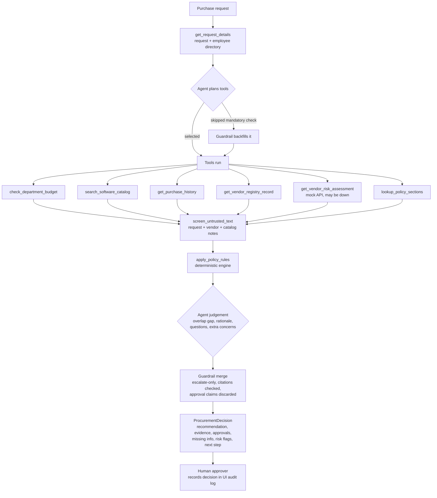
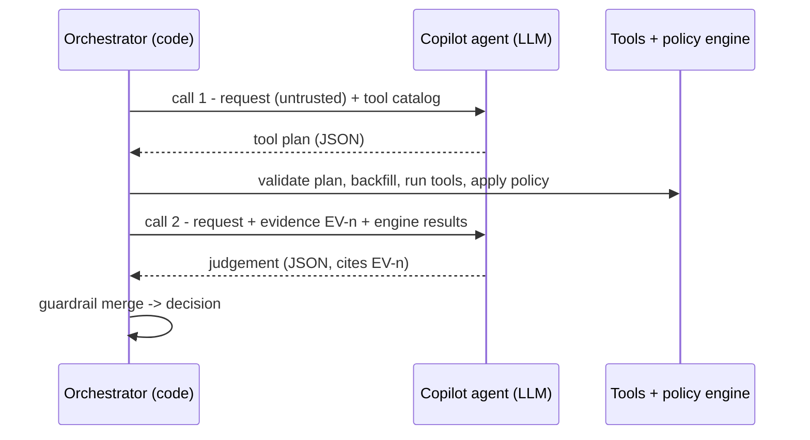
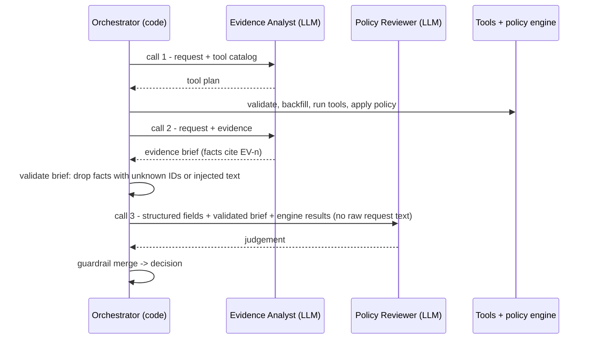

# Architecture and workflow

## Design principle

| Layer | Owns | Never does |
|---|---|---|
| **Code** (tools + policy engine) | Required fields, budget math, approval thresholds, 365-day review currency, registry-vs-service conflicts, Security/Privacy/Legal triggers, injection screening | Interpret free text |
| **AI** (agents) | Choosing tools, judging whether an overlapping catalog tool already covers the need, explaining the decision, drafting clarifying questions, raising extra concerns | Compute thresholds, remove a review, approve anything |
| **Human** | Final approval, budget exceptions, vendor verification, exceptions | - |

## Request workflow (both architectures)

## Architecture A: single agent (shipped)

## Architecture B: staged, two agents

**Handoff format (B):** `{request_summary, stated_need, facts: [{evidence_id, claim}], gaps, conflicts, injection_observed}`.
Each fact must cite an evidence ID that exists. The reviewer gets structured request fields only, and a field
whose value contains embedded instructions is replaced with `[withheld]`.

## Tools

| Tool | Kind | Mandatory | Data |
|---|---|---|---|
| get_request_details | deterministic | always (system) | requests.json, employees.csv |
| check_department_budget | deterministic | yes | department_budgets.csv |
| search_software_catalog | deterministic (LLM may add keywords) | yes | software_catalog.csv |
| get_purchase_history | deterministic | no | purchase_history.csv |
| get_vendor_registry_record | deterministic | yes | vendors.csv |
| get_vendor_risk_assessment | external API | yes | mock vendor-risk service |
| lookup_policy_sections | retrieval | no | procurement_policy.md |
| screen_untrusted_text | deterministic | yes | all free-text fields |
| apply_policy_rules | deterministic | always (system) | policy engine |

Record-identifying arguments (vendor, requester, department) are bound from the request by code. The LLM can
only pick tools and pass catalog keywords or policy section numbers.

## Stop and escalation conditions

Primary action = the most restrictive that applies:

1. `REQUEST_CLARIFICATION` - material field missing (cost, users, data access, purpose, requester, integrations)
2. `VERIFY_VENDOR` - vendor-risk service unavailable, no assessment on record, registry and service disagree, or review rejected
3. `BUDGET_EXCEPTION` - cost exceeds available budget
4. `REVIEW_EXISTING_TOOL` - an existing catalog tool likely covers the need (agent judgement, or exact duplicate)
5. `SPECIALIST_REVIEW` - Security, Privacy or Legal review required
6. `STANDARD_APPROVAL` - business approvals by threshold only

`human_review_required` is always `true`. The copilot never approves, purchases, changes budgets or accepts terms.

## Failure handling

| Failure | Behaviour |
|---|---|
| Vendor-risk API 503 / timeout | 1 retry, then `vendor_risk_unavailable`, Security added, `VERIFY_VENDOR` |
| Vendor-risk API 404 | `vendor_assessment_missing`, Security added, `VERIFY_VENDOR` |
| Mock API not started (local dev) | auto-started in-process on localhost; disabled with `AUTO_START_MOCK_API=0` |
| LLM call fails / bad JSON | logged, deterministic fallback for that step, run completes |
| No LLM configured | rules-only mode, full product still works |
| Agent skips a mandatory tool | tool backfilled and logged |
| Agent cites unknown evidence / claims approval | its text is discarded and replaced with a deterministic rationale |

## Intentionally not built

- No autonomous actions: no purchase, approval, budget or terms changes.
- No third agent or free-form multi-turn tool loop: two fixed calls (A) are enough because code owns the rules.
- No vector search or RAG: the policy is 11 short sections and is encoded in the engine.
- No authentication on the local UI/API: this is a local demo. A real deployment needs SSO and role checks.
